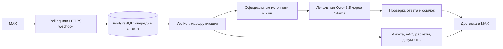

# Архитектура, данные и интеграции

## Обработка сообщения



Приём сообщений отделён от подготовки ответа. Worker читает сохранённое состояние пользователя, выбирает сценарий и сохраняет результат перед доставкой. Неудачная доставка повторяется; уже подготовленный ответ не генерируется заново. После исчерпания попыток событие остаётся в очереди ошибок для диагностики.

## Модель и поиск

По умолчанию используется `qwen3.5:9b` через Ollama. Модель разбирает неоднозначные деловые вопросы, выбирает кандидатов ОКВЭД и составляет выжимку из найденных материалов. Приветствия, основные шаги анкеты, известные персональные вопросы и расчёты выполняются кодом.

Каталог `config/sources.json` ограничивает поиск официальными источниками. Исследователь загружает и индексирует страницы, использует свежий кэш и передаёт релевантные фрагменты модели. Выжимка содержит до шести пунктов со ссылками. Проверяются идентификаторы источников, числа и ряд условий; при отклонении ответа модель получает замечания, затем при необходимости выполняется уточнённый поиск. Эти проверки уменьшают риск ошибок, но не доказывают юридическую полноту ответа.

Общий таймер обработки отключён. `AI_TIMEOUT_SECONDS=0` означает отсутствие лимита одного вызова модели. `AI_THINK=false` — обычная генерация; необязательный режим `true` включает внутреннее рассуждение и может существенно увеличить время. Служебные рассуждения не отправляются в чат.

## ОКВЭД

Подбор использует [официальный API ФНС](https://service.nalog.ru/okved/doc/open-api.pdf) и локальную копию классификатора `config/okved_reference.json`. Модель получает только найденных кандидатов, а код и название проверяются по справочнику. Неоднозначное описание требует уточнения и подтверждения пользователя. Проверенные типовые варианты хранятся в `config/activities.json`.

Обновление снимка:

```bash
python -m scripts.update_okved
```

После обновления перезапустите worker. Снимок позволяет подбирать кандидатов при недоступности API; для выбора по свободному описанию требуется работающая локальная модель.

## Хранилище и персонализация

PostgreSQL хранит анкеты, согласия, состояние маршрута, очередь, историю вопросов, кэш документов, подписки и напоминания. Данные выбираются по идентификатору пользователя MAX. Модель получает только разрешённые поля анкеты, относящиеся к вопросу; ФИО, ИНН и email из черновика формы не включаются в поисковый контекст.

Вопрос может рассматривать альтернативные условия без изменения профиля. Постоянные изменения задаются через `/set`; `/profile` показывает текущие данные. `/delete` удаляет данные в приложении; сообщения в MAX и ранее созданные резервные копии остаются вне этой операции.

## Интеграции

| Система | Назначение |
| --- | --- |
| MAX Bot API | Получение сообщений, ответы и файлы |
| PostgreSQL 17 | Профили, очередь, кэш и состояние |
| Ollama | Локальная генерация без платного API |
| Сайты ФНС и API ОКВЭД | Материалы для ответа и классификатор |
| Caddy | HTTPS для webhook |

Автоматическая подача в ФНС, получение статуса ЕГРИП, Госуслуги, банки и отправка email не интегрированы. `/online` открывает официальный сервис для самостоятельной подачи.
