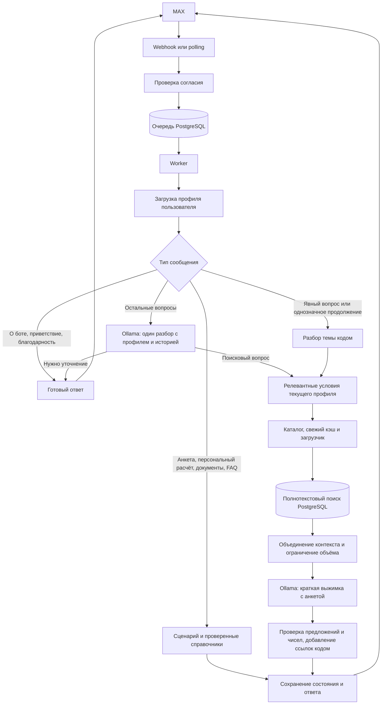

# Сценарии, локальная модель и поиск документов

Большая часть диалога работает без нейросети: [пошаговый Guide](../ip_bot/guided.py), анкета, персональные расчёты и документы, ОКВЭД из ограниченного справочника, регистрация, PDF, FAQ и настройки уведомлений. После `/start` и `/consent` бот сам задаёт следующий вопрос; `/continue` восстанавливает сохранённый шаг. Поддерживаемые персональные вопросы, в том числе с `/ask`, обрабатываются по сохранённому профилю. Остальные предметные вопросы проходят в поиск по разрешённому каталогу, затем локальная Ollama делает краткую выжимку с учётом анкеты. Неоднозначный вопрос предварительно разбирается моделью. Платные AI и поисковые API не используются.

Модель задаётся в `OLLAMA_MODEL`; по умолчанию используется [qwen3.5:2b-q4_K_M](https://ollama.com/library/qwen3.5:2b-q4_K_M), около 1,9 ГБ, Apache 2.0. Подготовка вместе с БД ограничена 24 секундами: разбор — до 8 секунд, поиск — до 8 секунд, модель — до 20 секунд суммарно на разбор и выжимку. Все этапы учитывают остаток общего времени. На попытку доставки отводится 5 секунд, на запись сбоя — 1 секунда. Очередь, повторы и внешние сервисы могут увеличить полное ожидание. Короткое уведомление о неуспехе не считается ответом по существу. Скорость и долю успешных выжимок на CPU-VM ещё нужно измерить; результаты Mac с Metal нельзя переносить на неё напрямую.



Webhook отвечает HTTP 200 только после сохранения события. Модель запускается в другом процессе. Worker удерживает advisory lock PostgreSQL: одна база обслуживается одним worker. Сеть и генерация выполняются без открытой транзакции; сохранение ответа, анкеты и истории атомарно. Готовый ответ или PDF повторно не создаётся после сбоя доставки.

## Сценарии без модели

`Journey` ведёт пользователя от `/begin` и `/okved` к `/taxes`, `/register`, `/checklist` и `/steps`. `/cancel` приостанавливает сценарий, `/back` возвращает к предыдущему вопросу, `/set` меняет параметры. `/ask вопрос` позволяет задать отдельный вопрос, сохранив текущий шаг.

[personal.py](../ip_bot/personal.py) распознаёт ограниченный набор персональных формулировок: вопросы о сохранённом регионе, деятельности, доходах, расходах, работниках, клиентах и ОКВЭД, «Какой режим мне подходит?», «Сколько мне платить налогов?», «Какие документы мне нужны для регистрации ИП?». `Journey.personal_answer` возвращает сохранённые сведения, заново рассчитывает налоги по текущим данным или строит регистрационный чек-лист. Неполная бизнес-анкета переводит к недостающему вопросу; отсутствие гражданства, возраста или способа подачи запускает соответствующее уточнение. Общий вопрос «Какие документы мне нужны?» вызывает уточнение действия: открытие, закрытие, изменение сведений или отчётность. Наличие регистрационных данных в профиле само по себе не означает, что пользователь снова спрашивает об открытии ИП. Эти маршруты не вызывают модель и не выполняют новый обход сайтов.

- ОКВЭД: 11 записей в [activities.json](../config/activities.json), распознавание основных примеров и уточнения. Дополнительные коды появляются только для описанных работ. Для неизвестной деятельности предлагается официальный поиск ФНС; это не полный классификатор и не универсальная проверка лицензий.
- Налоги: расчёт кодом по [tax_rules.json](../config/tax_rules.json), текущий алгоритм — 2026 год. «Сколько мне платить налогов?» при выбранном режиме даёт короткий итог и ограничения; `/tax режим` открывает подробности, `/taxes` — сравнение. Неизвестные ставки, патент, взносы за работников и условия допуска не заменяются выдуманными значениями. Условная сумма не подтверждает право применять режим.
- Регистрация: чек-лист зависит от гражданства, возраста и способа подачи. `/form` переносит общие поля и ОКВЭД в [официальный бланк Р21001](../config/forms/README.md). Это частичный черновик, который не готов к подаче. Паспорт, адрес и подпись пользователь заполняет самостоятельно. При неподдерживаемом формате выдаётся список данных для переноса.
- FAQ и уроки: готовый текст без модели. Опубликованный FAQ заменяет встроенную версию. Если ответа нет, доступны `/ask` и `/consultant`; контакт задаётся через `CONSULTANT_URL` и может отсутствовать.
- Напоминания и новости: отдельное согласие пользователя, задания в PostgreSQL и повторы доставки. Календарь ограничен [регистрацией ИП и поддерживаемыми сроками 2026 года](spec-coverage.md#календарь-uc08); из 2027 года включены проверка дополнительного взноса и декларация УСН за 2026 год. Ежемесячные НПД/АУСН — условная проверка начислений, только для сроков 2026 года. Новости готовит редактор; публикация и постановка в очередь — разные действия.

Данные анкеты не передаются банкам, Госуслугам или ФНС. `/online` открывает официальный сервис без передачи анкеты и без получения статуса заявки. Загрузка синтетического PDF через API MAX с получением токена файла проверена; доставка вложения в пользовательский чат ещё не проверена. [Матрица UC01–UC12](spec-coverage.md) описывает границы ТЗ.

## Сохранённый профиль и приоритет условий

`Store` загружает `profiles.state` и историю по `user_id` входящего события. Состояние переживает перезапуск процесса; профиль и история соседнего пользователя не включаются в запрос. `Journey` работает с копией состояния, а [profile_context.py](../ip_bot/profile_context.py) создаёт отдельный контекст для каждого вопроса. Общего изменяемого профиля в планировщике нет.

`build_profile_context(state, question)` пропускает только разрешённые поля: плоские `activity`, `region`, `revenue`, `expenses`, `employees`, `clients`; разрешённые налоговые уточнения в `tax_options`; `selected_regime`; основной и дополнительные коды `okved`; `registration.citizenship`, `age`, `method`, `date`; `timezone`. Вложенные значения проверяются по типу и формату. Поля `form` с ФИО, ИНН и email, идентификатор пользователя, согласие и служебное состояние Guide не копируются в этот профиль. История передаётся отдельно. При отсутствии разрешённых сведений контекст пустой; недостающие данные не заменяются нулём или догадкой.

Приоритет задан так: явные условия текущего вопроса → текущая сохранённая анкета → история для разрешения ссылок на предмет разговора. «А если в Москве?» исключает прежний регион и зависимые региональные настройки из контекста этого вопроса, сохраняя саму анкету. Простое упоминание поля, например «Как отразить гражданство в форме?», не является его изменением. Список `omitted_fields` содержит имена подавленных defaults; это не новые значения. Распознавание переопределений ограничено простыми явными формулировками, а инструкция модели не гарантирует правильный разбор любого противоречия.

`/profile` показывает сохранённые бизнес-ответы, выбранный режим, регистрационные сведения, ОКВЭД и налоговые уточнения. `/set` позволяет постоянно исправить поддерживаемое поле, например `/set регион Самарская область` или `/set доход 2000000`; зависимые параметры расчёта сбрасываются по правилам `Journey`. Гипотеза в отдельном поисковом вопросе не выполняет `/set`. Планировщик и модель выжимки получают актуальный разрешённый профиль. Выжимка не повторяет всю анкету перед ответом; в персональном расчёте сохраняются только нужные исходные условия и ограничения.

## Бюджет времени

`events.received_at` фиксирует попадание события в нашу БД и не меняется при повторе доставки. Для вопросов, требующих поиска (`needs_research`), worker учитывает возраст очереди в `PREPARATION_SECONDS=24`; единый монотонный deadline охватывает подготовку, обращения к БД и сохранение ответа. Локальные команды, анкета и разговорные реплики не отклоняются из-за возраста очереди: `/delete` и `/new` продолжают менять профиль и историю. `AI_TIMEOUT_SECONDS` по умолчанию и максимум равен 20 секундам; прежнее значение `600` понижается до 20. Это общий бюджет модели на вопрос: уже потраченное на разбор время вычитается перед выжимкой. Разбор ограничен `PLANNING_SECONDS=8`, поиск — `SEARCH_SECONDS=8`; для выжимки оставляется резерв, но все этапы ограничены остатком подготовки. Отсчёт начинается при сохранении в нашей очереди, не при нажатии кнопки пользователем. Для событий до миграции исходное время неизвестно и записано время миграции.

Предварительное сообщение «Проверяю…» удалено. Worker отправляет один итог: выжимку, уточнение либо короткое сообщение о неуспехе. Таймаут-реплика сохраняется для надёжной доставки, но не попадает в историю модели (`remember=False`). Одна попытка отправки ограничена `DELIVERY_SECONDS=5`, включая ожидание ограничения частоты, соединение и чтение ответа MAX; для PDF сюда входит загрузка вложения. На запись сбоя отведён `FAILURE_RECORD_SECONDS=1`. Готовый сохранённый ответ доставляется повторно без новой генерации даже после истечения бюджета; недоступность MAX и повторы могут вывести доставку за 30 секунд.

`ip_bot/budget.py` использует POSIX `setitimer`/`SIGALRM` в главном потоке на macOS/Linux; фоновые потоки и Windows не поддерживаются. Это ограничение времени выполнения приложения, не принудительное завершение процесса операционной системой: длительный вызов C может задержать Python-обработчик сигнала. [Ограничения обработчиков сигналов Python](https://docs.python.org/3/library/signal.html#execution-of-python-signal-handlers). Ограничения запросов и ожидания БД защищают обработку от зависания; они не гарантируют успешное завершение при недоступной БД. Очередь, задержки системных вызовов, слабая VM и сбои сети не позволяют обещать безусловную доставку полноценного ответа за 30 секунд.

## Разбор без лишней генерации

`ip_bot/conversation.py` узнаёт разговорные сообщения и их сочетания: «Привет, как дела, что нового?», «Ты тут, на связи?», «Давай поболтаем», «кто ты?», благодарности и `/about`. Ответ не требует модели или загрузки сайтов. Во время анкеты бот даёт короткую реплику и `/continue`, сохраняя ответы и шаг; налоговая таблица и документы к разговору не добавляются. Разговорным считается только сообщение, в котором распознаны все содержательные слова. Если после приветствия есть деловой вопрос, например «Привет, как дела? Какие документы нужны для регистрации ИП в Казани?», он передаётся в обычный разбор с сохранением города, даты, отрицаний и других условий. «Как дела с заявлением?» и «Что нового по УСН?» остаются предметными вопросами и не записываются вместо региона анкеты. Распознавание локальных формулировок ограничено; `/ask вопрос` остаётся явным способом задать отдельный вопрос.

`local_plan` в `ip_bot/routing.py` составляет план поиска для явно названного действия или налогового режима: регистрация и закрытие ИП, изменения ОКВЭД/ЕГРИП, номера форм, УСН, ПСН, НПД. Правила определяют тему и ключевые слова, не сообщая нормативных фактов. Исходный вопрос с регионом и периодом сохраняется. За пределами описанного персонального маршрута правила поиска не угадывают предмет вопроса «Какие документы мне нужны?» по отдельным словам.

`context_plan` разбирает узкие продолжения вроде «А куда его подавать?» без модели, если последний вопрос самого пользователя явно называет одну известную форму. Он проверяет две последние пары вопрос–ответ: они должны относиться к той же теме и не содержать конкурирующих номеров форм. Одного упоминания формы в ответе бота недостаточно. После простого «Как заполнить Р21001?» правило работает и при заполненной анкете: в запрос переносится форма и новое действие, а актуальные условия добавляются из профиля. Прежнее действие «заполнить» не копируется в вопрос о подаче. Более сложная история при наличии профиля, новые условия, регион или период в уточнении передаются модели. При пустом профиле условия принятого правилами предыдущего вопроса сохраняются целиком. Правила не добавляют нормативных фактов.

Для остальных вопросов `ip_bot/llm.py` вызывает локальный `/api/chat`: JSON Schema, `think=false`, `stream=false`, `temperature=0`. Модель возвращает короткий `QuestionIntent`, проверяемый Pydantic:

- `action`: `search`, `clarify` или `offtopic`.
- `text`: поисковая фраза до 400 символов. Для `clarify` и `offtopic` системная инструкция требует пустую строку.
- `topics`: до двух идентификаторов из фиксированного списка тем; для поиска нужен хотя бы один.

Модель получает весь разрешённый профиль текущего вопроса, включая налоговые уточнения, выбор режима, ОКВЭД и регистрацию, и две последние пары вопрос–ответ, обрезанные до 250 и 400 символов соответственно. Текущий вопрос выделен отдельно после контекста. Инструкция требует сохранять действие, регион, период, форму, возраст и гражданство, брать актуальные условия из профиля, а историю использовать для уточнения предмета. Явные альтернативы пользователя имеют приоритет и не изменяют сохранённый профиль. Код преобразует результат через `QuestionIntent.to_plan()` во внутренний `Plan`: устанавливает `query`, `clarification`, `relevant` и пустой `keywords`. При `clarify` с пустым `text` код подставляет готовый вопрос о документе или действии. Модель не генерирует отдельный список ключевых слов и не пишет нормативный ответ пользователю.

Перед поиском код проверяет числа в запросе модели по вопросу, всему разрешённому профилю и двум полным сохранённым ответам. Так учитываются сохранённые суммы, возраст, даты, коды ОКВЭД и номер формы за пределами короткой выдержки истории. Записи суммы с незначащими десятичными нулями, например `1200000` и `1200000.00`, сопоставляются. Новое число, например придуманный номер формы, вызывает просьбу об уточнении без поиска; отдельно допускаются текущий год и соседний год при соответствующей относительной дате в вопросе. Проверка чисел не доказывает сохранение всех смысловых условий.

Оба пути поиска — локальный и модельный — проходят через `enrich_plan`. Он сохраняет исходный запрос целиком и добавляет до трёх релевантных условий анкеты, не более 120 символов и 12 слов, а также до двух ключевых слов в пределах общего лимита восьми. Новые условия не должны вытеснять исходные термы из ограничения полнотекстового поиска в 20 термов. Например, поиск регистрационных документов может получить гражданство, возраст, способ подачи и регион, но не весь набор налоговых сумм. Если места не хватает, условие пропускается целиком. Профиль помогает выбрать материалы, но не превращает выдержку в доказательство применимости нормы к человеку.

Разговор, анкета и поддерживаемые персональные ответы не вызывают модель. Успешный поиск по локально разобранному вопросу использует один вызов для выжимки; неоднозначный вопрос — до двух: разбор и выжимку. При уточнении, посторонней теме или отсутствии материалов второй этап не выполняется.

## Получение материалов

Модель не исполняет команды и не выбирает URL для загрузки. `ip_bot/sources.py` начинает с `config/sources.json`, затем ранжирует ссылки по ключевым словам. Проверяются HTTPS, домен, отсутствие учётных данных и нестандартного порта, публичность всех DNS-адресов и каждый redirect. TCP-соединение привязано к проверенному IP, TLS — к имени сайта. Проверка robots.txt выполняется до загрузки каждой цели. Между запросами к хосту выдерживается пауза.

Ограничения: до 5 страниц по умолчанию, глубина 2, 6 МБ на файл, 25 страниц PDF, до 100 тысяч символов документа. HTML читается без JavaScript; PDF требует текстового слоя; DOCX извлекается без исполнения содержимого. OCR, входящие вложения MAX, старый DOC, архивы и sitemap не поддерживаются. Скан Р21001 хранится отдельно как заранее проверенный шаблон; это не добавляет OCR в поиск.

Загрузчик учитывает общий deadline при запросах, ожидании между ними и обходе. Если между страницами остаётся меньше секунды, он прекращает обход и возвращает найденные фрагменты со служебной отметкой `search_budget_exhausted`. Такой обход не записывается как успешно завершённый поиск в кэш. При полном исчерпании бюджета обработка прерывается; частичные материалы не гарантируют полноту перечня документов.

PostgreSQL хранит URL, заголовок, тип, время получения, хеш текста, ссылки, версию извлечения и фрагменты. Фрагменты по 1000 символов с перекрытием 160 индексируются `to_tsvector('russian', ...)`. Поиск использует успешно прочитанные страницы или подходящий свежий кэш. Проверяются срок хранения и версия извлечения; при изменении документа старые фрагменты заменяются. Просроченные материалы при неудачном обновлении не выдаются как свежие. Новый вопрос может потребовать загрузки дополнительных страниц. Векторная БД не требуется.

Извлекатель версии 3 выбирает статью современных страниц ФНС в `#divSecondPageColumns .page-content__center`, убирает меню и сохраняет блоки `.note` с существенными условиями. Кэш с прежней версией не считается свежим. В каталоге регистрации используется содержательная статья `rn77/ip/interest/reg_ip/petition/` вместо обзорной страницы `reg_ip/`; московская привязка `rn77` сохраняется.

## Ответ и ограничения качества

Несколько пунктов выжимки отображаются нумерованным списком с пустыми строками между пунктами; ссылки вынесены в отдельный блок. Перед отправкой в MAX [formatting.py](../ip_bot/formatting.py) сохраняет абзацы и разделяет явные списки, склеенные в одну строку. Форматирование выполняется кодом, без дополнительного вызова модели.

PostgreSQL возвращает до четырёх совпадений полнотекстового поиска и добавляет соседний контекст той же страницы. `summary_passages` объединяет пересекающиеся фрагменты по адресам; непересекающееся продолжение того же источника сохраняется с обозначением пропуска. В [summarization.py](../ip_bot/summarization.py) текст каждого источника сокращается до 1500 символов по целым предложениям. Код удаляет распознанное меню, служебные номера и заголовки, затем выбирает до трёх пригодных источников. Поэтому меню среди первых результатов не должно вытеснять четвёртый полезный источник. Короткие смысловые условия сохраняются; длина предложения сама по себе не повод удалить его.

Модель получает текущий вопрос, разрешённый профиль, уточнённый запрос и `sources`: ID и заголовок источника, список `sentences` с `{id, text, segment}` и признак `truncated`. Для распознанных вопросов «куда подавать», «как заполнить» и о пошлине `focus` задаёт целевые предложения с учётом способа подачи; `primary_evidence` повторяет их ID и текст. При наличии `focus` вход ограничивается его источниками и окнами до двух соседних предложений с каждой стороны. Исходные ID сохраняются; пропуски обозначаются разными `segment` и `truncated`, без склейки в непрерывную цитату.

Первый пункт ответа должен ссылаться на `focus`, а все использованные ID — присутствовать во входе модели. Для вопроса о месте подачи соседнее явное требование уточнить оказание услуги, например в выбранном МФЦ, добавляется в `required_conditions`. Если модель пропустила такое условие при допустимом основном ответе, код добавляет короткое предложение дословно из источника отдельным пунктом, сохраняя проверки видимого ID и источника, максимум три пункта и общий лимит 1500 символов. Это узкие проверки известных ошибок; они не доказывают сохранение всех смысловых условий.

Модель возвращает `Summary`: до трёх пунктов `{text, source, evidence}`. `text` ограничен 240 символами, `source` указывает источник, а `evidence` — номер подтверждающего предложения в нём. Модель не перепечатывает цитату: код сам извлекает выбранное предложение для проверки. Это уменьшает объём генерации и исключает ошибки копирования цитат. Пользователь видит прямой ответ, при необходимости действия или существенные условия, затем ссылки. Общая длина ограничена 1500 символами вместе со ссылками; напоминание `/continue` добавляется только если помещается в этот же лимит. Состояние анкеты сохраняется и без напоминания. Большие цитаты не выводятся.

Код проверяет схему, существование выбранного предложения именно в указанном источнике, числа и номера форм, способы подачи, простые признаки отрицаний и смысловой связи. Допускается повторить Р-номер формы, уже явно названный в текущем вопросе или проверенном запросе; это не разрешает придумывать суммы, сроки или другие числа. Остальные числа и распознаваемые способы подачи должны подтверждаться выбранным предложением: анкета и соседний текст не заменяют такое подтверждение. URL добавляются только из найденных разрешённых источников; модель не задаёт адреса. При провале проверки выжимка целиком отклоняется, чтобы не удалить только оговорку. При недостатке сведений возможен честный запрос уточнения. Эти проверки отсеивают часть ошибок, но выбранное предложение не доказывает правильность пересказа: модель всё ещё может ошибиться в смысле, области действия или полноте ответа. Основной текст ФНС отделяется от меню, а версия извлечения хранится в кэше.

Наличие источника не гарантирует актуальность нормы и правильность ранжирования. Нормативные версии, даты действия, региональные ставки, противоречия и полнота перечня документов не проверяются отдельным движком. Сейчас начальные страницы ФНС включают московский раздел `rn77`; автоматической подстановки региона нет. Сложные юридические выводы требуют проверки человеком.

Недоступность модели, источников и отсутствие материалов обрабатываются явно. Если выжимка не прошла проверку или не успела сформироваться, пользователь получает короткое сообщение и, если материалы уже есть, ссылки. Старый ответ из больших выдержек не используется как запасной вариант. Поиск ограничен каталогом и связанными страницами, а не всем интернетом.

## Состояние и эксплуатация

- `profiles`: согласие, бизнес-анкета, этап сценария, выбор режима, настройки и введённые данные Р21001.
- `events`: очередь с `received_at`, сохранённый ответ и PDF, доставка, повторы и ошибки без текстов исключений.
- `conversation_turns`: последние 20 вопросов и ответов пользователя; при разборе неоднозначного вопроса планировщику передаются две последние пары.
- `documents`, `passages`: кэш и индекс источников.
- Таблицы `service_*`: подписки, напоминания, очередь уведомлений и оценки.
- Таблицы `knowledge_*`: версии материалов, активные публикации и журнал действий.
- `analytics_counters`: анонимные количества действий по известным сценариям; админка показывает последние 30 дней и агрегированный прогресс анкеты.
- `meta`, `schema_migrations`: marker MAX, привязка к боту и версии БД.

До `/consent` произвольный личный текст заменяется запросом согласия перед записью в очередь. `/delete` и отказ удаляют профиль, историю, подготовленные файлы из очереди, подписки и напоминания из рабочей базы. Сообщения в самом MAX и старые резервные копии остаются вне этой операции. `/new` начинает анкету заново, сохраняя ранее данное согласие. Доставленные события сохраняют идентификаторы для дедупликации, но их текст, ответ и PDF очищаются. В прикладных логах нет вопросов, ответов, токенов и строк подключения.

Админка использует отдельный `ADMIN_TOKEN`: локально `python -m scripts.admin` загружает `.env`, на VM Compose-профиль `admin` публикует порт только на loopback. [Доступ и SSH-туннель](../README.md#администрирование). Доступны черновики, предпросмотр на синтетических данных, публикация и откат `faq`, `news`, `tax_rules`, `activities`. Новый налоговый год, формула или правило распознавания требуют изменения кода. Проверка схемы не заменяет проверку официальных источников редактором. Для новости после публикации требуется отдельная постановка в очередь подписчиков.

Для VM без GPU задано `AI_DEVICE=cpu`: запрос Ollama содержит `num_gpu=0`. На Mac с нативным Ollama можно задать `AI_DEVICE=auto`, чтобы Ollama выбрала доступное устройство, включая [Metal](https://docs.ollama.com/gpu). Это поле автоматически не меняет существующий `.env`. После изменения настроек перезапустите worker. При переносе настроек на CPU-VM верните `AI_DEVICE=cpu`.

По умолчанию используются 4096 токенов контекста, 4 потока и суммарный лимит модели 20 секунд на вопрос. `AI_KEEP_ALIVE=30m` [оставляет модель в памяти](https://docs.ollama.com/faq) на 30 минут после вызова и сокращает повторные загрузки. На CPU разбор или выжимка могут не уложиться в бюджет. Быстрая обработка входящего webhook не означает мгновенную доставку ответа: сообщения проходят через одного worker. Для нагрузки нужны измерения и отдельное проектирование параллельной обработки.

При запуске worker пытается прогреть модель через `Ollama.warmup()`: отправляет пустой список сообщений с теми же настройками устройства и контекста, без генерации ответа. Общий лимит соединения и чтения — `min(AI_TIMEOUT_SECONDS, 20)`, по умолчанию 20 секунд; превышение даёт `model_warmup_timeout`. Успех или код ошибки записывается в лог; неудачный прогрев не останавливает worker. Получатель MAX продолжает сохранять сообщения, пока worker прогревается, и это ожидание уменьшает оставшийся бюджет поиска. Прогрев не гарантирует, что модель останется в памяти после длительного простоя или нехватки памяти.

Локальный `scripts/serve_ai.sh` и Compose устанавливают `OLLAMA_MAX_LOADED_MODELS=1` и `OLLAMA_NUM_PARALLEL=1`: одновременно загружена одна модель, запросы к модели выполняются по одному. Проверки разных моделей запускаются последовательно. Эти параметры начинают действовать после перезапуска Ollama; подключение launcher к уже работающему серверу само его настройки не меняет.

## Проверки

После загрузки `.env` в окружение:

| Команда | Что проверяет |
| --- | --- |
| `python -m unittest discover -s tests -v` | Логика, PDF, бюджеты и API-заглушки; PostgreSQL при `TEST_DATABASE_URL` |
| `python -m scripts.check_spec` | Синтетические сценарии ТЗ, публикация/откат и удаление данных; без модели, сайтов и MAX |
| `python -m scripts.smoke_ai` | Реальные Ollama, PostgreSQL и страницы ФНС |
| `python -m scripts.benchmark` | Разговор, анкета, пустой кэш, повтор, уточнение и госпошлина через МФЦ; время, длина, профиль, ссылки и отсутствие крупных цитат |
| `python -m scripts.benchmark --skip-model` | Только разговор и локальные ответы по анкете; весь поиск с нейронной выжимкой пропускается |

Проверки сценариев и поиска создают и удаляют временную схему в `DEMO_DATABASE_URL`. Отчёты: `data/spec-check.json`, `data/ai-integration-check.json`, `data/performance-check.json`; полный прогон тестов — `data/test-results.txt`. [Тесты выжимки](../tests/test_summarization.py) проверяют источники и ID предложений, числа, формы, способы подачи, длину и отклонение неподтверждённых пунктов. [Проверки benchmark](../tests/test_benchmark.py) не позволяют засчитать быстрый таймаут или запасные ссылки как успешную выжимку.

Прежние измерения поиска без модели относятся к версии с выдержками. В новом benchmark обычный поиск и повтор из кэша требуют вызова модели для выжимки; кэш экономит загрузку страниц. Длина и смысл ответа оцениваются вместе со временем. Приём и доставка MAX не измеряются, а создание PDF не подтверждает его доставку. [Результаты и ограничения](../README.md#проверки). CPU-VM и доставка MAX требуют отдельного измерения.

## Проверка качества планировщика

`scripts/evaluate_planner.py` сравнивает реальные ответы Ollama на восьми синтетических сценариях из [planner_cases.json](../tests/fixtures/planner_cases.json). Среди них — неясная ссылка на документ, гражданство и регион, закрытие ИП с уточнением режима, новый период, исправление предыдущего запроса, историческая дата, посторонняя тема и попытка навязать ответ. Настоящие пользовательские сообщения и секреты в фикстуру не входят.

После загрузки настроек в окружение:

```sh
.venv/bin/python -m scripts.evaluate_planner --model "$OLLAMA_MODEL" --device cpu
```

`--device auto` позволяет Ollama выбрать доступное устройство на Mac; `--case ID` запускает отдельный сценарий, `--output PATH` сохраняет отдельный отчёт для сравнения моделей. PostgreSQL, MAX и сайты источников в этой проверке не вызываются. Разбор выполняется прямо через модель, обходя `local_plan` и `context_plan`, чтобы быстрые правила не скрывали ошибки модели.

Скрипт получает текущие prompt и схему у Assistant. Дата в prompt фиксируется значением `today` из фикстуры, чтобы «со следующего года» имело одинаковый смысл во всех прогонах. Отчёт `data/planner-quality-check.json` обновляется после каждого сценария и содержит исходный `QuestionIntent`, преобразованный `Plan`, общее время вызова, время загрузки модели, обработки prompt и генерации, а также количество токенов. Предварительного прогрева нет: первый вызов может включать загрузку, а последующие — использовать кэш. Эти условия нужно учитывать при сравнении времени.

Автоматически проверяются схема ответа, принадлежность к теме, необходимость уточнения, включение и исключение тем, сохранение ожидаемых чисел и отсутствие новых чисел. Группы допустимых слов проверяют наличие основных условий с учётом вариантов формулировки. Проверки не требуют дословного совпадения всей поисковой фразы. Сохранение смысла, исправлений, отрицаний, региона и периода, а также отсутствие придуманных нормативных фактов оцениваются вручную по полям `manual_review`. Прохождение автоматических проверок не является гарантией правильного смысла или достаточного качества новой модели.
